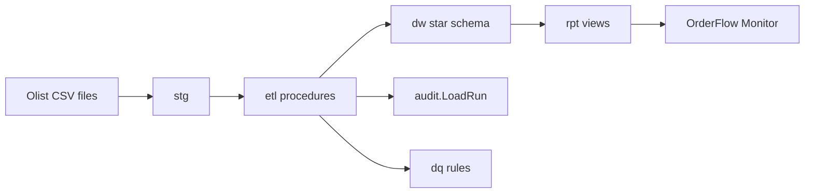

# OrderFlow DW

OrderFlow DW is a SQL Server 2025 data warehouse built from the public [Olist Brazilian E-Commerce](https://www.kaggle.com/datasets/olistbr/brazilian-ecommerce) dataset. CSV files land in `stg`, T-SQL procedures build a sales and payments star schema in `dw`, and every load writes a row to `audit`. A later SSIS catalog run on Windows calls that same path. GitHub Actions builds the database project, publishes it to a fresh SQL Server 2025 container, and runs the tSQLt suite. The OrderFlow Monitor app only reads `rpt` views.



Work the steps in order. Each one has a finish check and a commit. The suggested message matches that step. If you add or drop files, change the message before you commit.

Tick the box for a step in this file as part of that step's commit.

## Decisions

| Topic | Choice |
| --- | --- |
| Engine | SQL Server 2025. Docker image `mcr.microsoft.com/mssql/server:2025-latest`, edition `EnterpriseDeveloper` |
| Local database | Container on port **14333**, database `OrderFlowDW`, compatibility level **170** |
| First load path | T-SQL `BULK INSERT`. SSIS comes after staging and audit exist |
| First proof | Six schemas, one Olist file loaded, one `Succeeded` row in `audit.LoadRun` |
| Model | `DimDate`, `DimCustomer`, `DimProduct`, `DimSeller`, `FactOrderItem`, `FactPayment` |
| Customer history | Synthetic second batch, then SCD2 on `DimCustomer`. Product and seller stay SCD1 |
| Tests | tSQLt, run locally and in GitHub Actions |
| App | Public repo. Streamlit Monitor only after the warehouse, tests, and `rpt` views exist |
| Data license | Olist is CC BY-NC-SA 4.0. Commit the tiny category file only. Keep the full download out of Git |

The Windows SQL Server instance is for SSIS later. Milestone work until Step 15 uses the Docker container. Before Step 15, run `SELECT @@VERSION` on Windows and install SQL Server 2025 Developer if that instance is still 2022. Integration Services, the SSIS Catalog, and SSMS are installed in that step.

## Model rules

These stay fixed from Step 8 onward.

- `DimCustomer` grain is `customer_unique_id`. `customer_id` is one id per order and stays on `FactOrderItem` as a degenerate key.
- `FactOrderItem` grain is `order_id` + `order_item_id`.
- `FactPayment` grain is `order_id` + `payment_sequential`. Payment amounts stay on that fact.
- `DimDate` holds one row per day from 2016-01-01 through 2018-12-31. The order fact has separate date keys for purchase, approval, carrier handoff, delivery, and the estimated delivery.
- Unknown members use surrogate key `-1`.
- Geolocation is loaded into `stg` and left out of the star. ZIP prefixes repeat and the names are dirty.
- Reviews are loaded into `stg` and left out of the star.
- The first tables are rowstore. Columnstore is a later experiment on the facts, inside the feature write-ups.
- The native `json` type is still in preview on SQL Server 2025. Regex functions and optimized locking are available. Optimized locking stays off until accelerated database recovery is enabled.

## How to commit a step

Run these from this folder. Commit only the files named in the step. `git status` should be clean before you start the next step.

```bash
git status
git diff
git add <files listed in the step>
git commit -m "$(cat <<'EOF'
Message from the step.

EOF
)"
git push
```

The first push is in Step 1 and needs `-u origin main`. After that, `git push` is enough.

Git uses the name and email already configured on this machine. See them with:

```bash
git config user.name
git config user.email
```

If either line is empty, set them for this repo, then commit:

```bash
git config user.name "Your Name"
git config user.email "you@example.com"
```

## GitHub Actions

GitHub Actions is the CI server attached to the GitHub repo. A workflow file in the repo tells GitHub which commands to run when you push. You use it from the browser and from the `gh` command. The workflow file itself is added in Step 17. Until that file is on GitHub, the Actions tab stays empty. That is expected.

### What a workflow is

A workflow is a YAML file under `.github/workflows/`. This project will have one, `ci.yml`. A **run** is one execution of that file. A run contains a **job**. A job contains **steps** (checkout, build, publish, test).

This project's workflow runs when:

- you push to `main`
- you open or update a pull request
- you start it by hand from the Actions tab (`workflow_dispatch`)

On each run it will:

1. Start a new SQL Server 2025 container.
2. Build `OrderFlow.Database` into a `.dacpac`.
3. Publish that dacpac to database `OrderFlowDW` inside the container.
4. Install tSQLt and run the test suite.
5. Fail the run when a test fails.

SSIS packages stay out of this workflow. The SSIS Catalog only runs on Windows, and GitHub-hosted runners are Linux.

Local development and CI use different passwords. The local password lives in `.env` and never goes to GitHub. The CI password is a GitHub **secret** named `MSSQL_SA_PASSWORD`.

### One-time setup on your machine

Install and sign in the GitHub CLI if `gh auth status` fails:

```bash
gh auth login
```

Choose GitHub.com, HTTPS, and login with the browser. Step 1 creates the public repo.

### Where to click

1. Open the repository on GitHub.
2. Open the **Actions** tab.
3. Before Step 17 you should see an empty list, or a prompt to enable Actions. Enable them if GitHub asks.
4. After Step 17, a run named **CI** appears for the push that added the workflow. Open the run, then the job, then a step, to read its log.
5. A green check on the commit means build, publish, and tSQLt succeeded. A red cross means open the first red step and read the first error. Later steps in that run are often noise from the first failure.
6. To run it again without a new commit: **Actions → CI → Run workflow → main**. To repeat a failed run: open the run → **Re-run failed jobs**.

From the terminal:

```bash
gh run list
gh run watch
gh run view --log-failed
```

`gh run watch` follows the latest run until it finishes. `gh run view --log-failed` prints the log of the steps that failed.

### Add the CI password before Step 17

Create a password that satisfies SQL Server (8 or more characters, and three of the four kinds: upper, lower, digit, symbol). Use a different password from `.env`.

```bash
gh secret set MSSQL_SA_PASSWORD
```

The command prompts for the value and does not print it. Confirm it exists with:

```bash
gh secret list
```

In the browser the same setting is **Settings → Secrets and variables → Actions → New repository secret**. The workflow reads it as `${{ secrets.MSSQL_SA_PASSWORD }}`. The YAML never contains the password.

### How to read a failure

| What you see | What it usually means |
| --- | --- |
| The job never starts, secret missing | `MSSQL_SA_PASSWORD` is not set. Add it, then re-run |
| SQL Server container exits during health check | Password too weak, or the server needs another minute. The workflow's health check already waits. Read the service log in the job |
| `dotnet build` fails | A `.sql` file in the project does not compile for SQL Server 2025. Fix the file, commit, push |
| SqlPackage publish fails | The dacpac built, and the target rejected an object. The publish log names the object |
| tSQLt step fails | The warehouse published, and a test assertion failed. The test name is in that step's log |
| Actions tab has no workflows | `.github/workflows/ci.yml` is not on the branch you pushed |

Push the fix as a normal commit. That push starts a new run. You do not restart anything on your machine.

### Badge

Step 20 adds this to the top of the README, after the default branch has one green run. Replace `YOUR_GITHUB_NAME` with your GitHub user or organization.

```markdown
[](https://github.com/YOUR_GITHUB_NAME/order-flow/actions/workflows/ci.yml)
```

## Progress

- [ ] Step 1. Put this guide on GitHub
- [ ] Step 2. Keep secrets and the full dataset out of Git
- [ ] Step 3. Run SQL Server 2025 in Docker
- [ ] Step 4. Add the database project and the six schemas
- [ ] Step 5. Record loads in `audit.LoadRun`
- [ ] Step 6. Load the category translation file
- [ ] Step 7. Load the other eight Olist files
- [ ] Step 8. Write down the star schema
- [ ] Step 9. Create the dimension and fact tables
- [ ] Step 10. Load the dimensions and facts
- [ ] Step 11. Simulate SCD2 customer history
- [ ] Step 12. Add the tSQLt suite
- [ ] Step 13. Load only new orders
- [ ] Step 14. Stop the load on a critical data-quality failure
- [ ] Step 15. Run the loads from SSIS on Windows
- [ ] Step 16. Write up SQL Server 2025 features
- [ ] Step 17. Build and test on every push with GitHub Actions
- [ ] Step 18. Add the read-only reporting views
- [ ] Step 19. Add the OrderFlow Monitor app
- [ ] Step 20. Finish the portfolio story

## Repository at the end

```
order-flow/
  src/OrderFlow.Database/       schemas, tables, procedures, rpt views
  src/OrderFlow.Tests/          tSQLt classes
  src/OrderFlow.ETL/            SSIS project, used on Windows
  src/OrderFlow.Monitor/        Streamlit app
  data/sample/                  category translation file, plus the synthetic customer batch
  data/olist/                   full Kaggle download, gitignored
  docs/                         star schema, feature notes, screenshots
  .github/workflows/ci.yml      build, publish, tSQLt
  docker-compose.yml
  .env.example
  README.md
```

Create a folder only when its step says to. Empty projects make the repo look further along than it is.

---

## Step 1. Put this guide on GitHub

You need a public GitHub repo before Actions can run. This file is the first commit.

**Done when:** GitHub shows this README on `main`, and the Actions tab opens.

```bash
git add README.md
git commit -m "$(cat <<'EOF'
Document the build sequence for OrderFlow DW.

EOF
)"
gh repo create order-flow --public --source=. --remote=origin
git push -u origin main
```

If `order-flow` is already taken on your account, pick another name and use it in the badge later.

Open the repo in the browser. Confirm the Actions tab loads. Leave it empty until Step 17.

**Commit:** `Document the build sequence for OrderFlow DW.`

## Step 2. Keep secrets and the full dataset out of Git

Create `.gitignore`:

```gitignore
.env
data/olist/
bin/
obj/
.vs/
*.user
*.dtproj.user
*.dacpac
__pycache__/
.venv/
```

Create `.env.example`:

```
MSSQL_SA_PASSWORD=ChangeMe_Now1!
```

Copy it to `.env` and replace the password with one you will actually use. `.env` stays on this machine.

**Done when:** `git status` lists `.gitignore` and `.env.example`, and does not list `.env`.

```bash
git add .gitignore .env.example
```

**Commit:** `Keep the SA password and the full Olist download out of Git.`

## Step 3. Run SQL Server 2025 in Docker

Install the .NET SDK (8 or later) in WSL if `dotnet --version` fails. The database project in the next step needs it.

Docker is already available. Give Docker Desktop at least 2 GB of memory. SQL Server exits when the limit is lower.

Create `docker-compose.yml`:

```yaml
services:
  sqlserver:
    image: mcr.microsoft.com/mssql/server:2025-latest
    container_name: orderflow-sql
    environment:
      ACCEPT_EULA: "Y"
      MSSQL_PID: EnterpriseDeveloper
      MSSQL_SA_PASSWORD: ${MSSQL_SA_PASSWORD}
    ports:
      - "14333:1433"
    volumes:
      - sql_data:/var/opt/mssql
      - ./data/sample:/data/sample:ro

volumes:
  sql_data:
```

Port 14333 leaves the Windows SQL Server instance on 1433 alone. `EnterpriseDeveloper` is the free Developer edition, so the container does not expire after 180 days.

```bash
mkdir -p data/sample
docker compose up -d
```

Wait until the container is healthy, then ask it for its version. The 2025 image ships `sqlcmd` at `/opt/mssql-tools18/bin/sqlcmd`. If that path is missing, look under `/opt` for `mssql-tools`.

```bash
docker compose exec sqlserver /opt/mssql-tools18/bin/sqlcmd \
  -S localhost -U sa -P "$MSSQL_SA_PASSWORD" -C \
  -Q "SELECT @@VERSION"
```

Load the password into the shell first (`set -a && source .env && set +a`) so `$MSSQL_SA_PASSWORD` is set. The version string should contain `2025` or major version `17`.

**Done when:** the query returns SQL Server 2025 and the container is still running.

```bash
git add docker-compose.yml
```

**Commit:** `Run SQL Server 2025 in Docker for local development.`

## Step 4. Add the database project and the six schemas

Create `src/OrderFlow.Database/OrderFlow.Database.sqlproj`:

```xml
<?xml version="1.0" encoding="utf-8"?>
<Project DefaultTargets="Build">
  <Sdk Name="Microsoft.Build.Sql" Version="2.3.0" />
  <PropertyGroup>
    <Name>OrderFlowDW</Name>
    <DSP>Microsoft.Data.Tools.Schema.Sql.Sql170DatabaseSchemaProvider</DSP>
    <ModelCollation>1033, CI</ModelCollation>
  </PropertyGroup>
  <ItemGroup>
    <PostDeploy Include="Scripts/Script.PostDeployment.sql" />
  </ItemGroup>
</Project>
```

`Sql170` is the SQL Server 2025 target. The SDK compiles every `.sql` file except the post-deploy script.

Create one file per schema under `src/OrderFlow.Database/Security/`:

```sql
CREATE SCHEMA stg AUTHORIZATION dbo;
```

Repeat for `dw`, `dq`, `audit`, `etl`, and `rpt`.

Create `src/OrderFlow.Database/Scripts/Script.PostDeployment.sql`:

```sql
ALTER DATABASE CURRENT SET COMPATIBILITY_LEVEL = 170;
```

Compatibility level 170 is what `REGEXP_LIKE` requires later.

Install SqlPackage once:

```bash
dotnet tool install -g microsoft.sqlpackage
```

Build and publish:

```bash
dotnet build src/OrderFlow.Database/OrderFlow.Database.sqlproj
sqlpackage /Action:Publish \
  /SourceFile:src/OrderFlow.Database/bin/Debug/OrderFlowDW.dacpac \
  /TargetServerName:localhost,14333 \
  /TargetDatabaseName:OrderFlowDW \
  /TargetUser:sa \
  /TargetPassword:"$MSSQL_SA_PASSWORD" \
  /TargetTrustServerCertificate:True
```

If the dacpac path differs, use the path `dotnet build` printed.

Check:

```bash
docker compose exec sqlserver /opt/mssql-tools18/bin/sqlcmd \
  -S localhost -U sa -P "$MSSQL_SA_PASSWORD" -C -d OrderFlowDW \
  -Q "SELECT name FROM sys.schemas WHERE name IN ('stg','dw','dq','audit','etl','rpt') ORDER BY name; SELECT compatibility_level FROM sys.databases WHERE name = 'OrderFlowDW';"
```

**Done when:** build produces a dacpac, publish succeeds, all six schemas exist, and the compatibility level is 170.

```bash
git add src/OrderFlow.Database
```

**Commit:** `Build an empty OrderFlow database as a dacpac.`

## Step 5. Record loads in `audit.LoadRun`

Add `src/OrderFlow.Database/audit/Tables/LoadRun.sql` with:

| Column | Role |
| --- | --- |
| `LoadRunId` | `int` identity, primary key |
| `LoadName` | `nvarchar(128)`, for example `stg.ProductCategory` |
| `SourceFile` | `nvarchar(260)` |
| `StartedAt` | `datetime2`, required |
| `EndedAt` | `datetime2`, null until the load finishes |
| `Status` | `nvarchar(20)`: `Running`, `Succeeded`, or `Failed` |
| `RowsStaged` | `int`, null until success |
| `ErrorMessage` | `nvarchar(4000)`, null unless the load fails |

Add three procedures in `etl`. Later loads, including SSIS, call these and do not insert into `audit.LoadRun` directly.

| Procedure | Behavior |
| --- | --- |
| `etl.StartLoad @LoadName, @SourceFile` | Inserts a `Running` row and returns `LoadRunId` |
| `etl.CompleteLoad @LoadRunId, @RowsStaged` | Sets `Succeeded`, `EndedAt`, and the row count |
| `etl.FailLoad @LoadRunId, @ErrorMessage` | Sets `Failed`, `EndedAt`, and the message |

Publish again. Call `etl.StartLoad` and `etl.CompleteLoad` once by hand and read the row back.

**Done when:** one manual call leaves a single `Succeeded` row, and a call to `etl.FailLoad` leaves a `Failed` row with the message.

```bash
git add src/OrderFlow.Database/audit src/OrderFlow.Database/etl
```

**Commit:** `Record load start, success, and failure in one place.`

## Step 6. Load the category translation file

Download the Olist dataset from Kaggle and unzip it on disk under `data/olist/`. That folder is gitignored.

Copy only this file into Git:

`data/sample/product_category_name_translation.csv`

It has about 70 rows and two columns: `product_category_name`, `product_category_name_english`.

Create `stg.ProductCategory`. Both columns are `nvarchar`, plus `LoadRunId int not null`. Staging keeps the file text. Types are applied when the warehouse is loaded.

Create `etl.LoadProductCategory`. It should:

1. Call `etl.StartLoad` with load name `stg.ProductCategory` and the source file name.
2. Delete existing rows from `stg.ProductCategory`.
3. `BULK INSERT` from `/data/sample/product_category_name_translation.csv` using `FORMAT = 'CSV'`, `FIRSTROW = 2`, and `CODEPAGE = '65001'`.
4. Set `LoadRunId` on the inserted rows.
5. Call `etl.CompleteLoad` with the inserted count.
6. On any error, call `etl.FailLoad` and rethrow.

`FORMAT = 'CSV'` is the load style the other files will reuse. It respects quotes, which the review file will need.

The container sees the file at `/data/sample/...` because of the volume in Step 3. Rebuild the container mount if you created `data/sample` after the first `docker compose up`:

```bash
docker compose up -d
```

Publish, run `EXEC etl.LoadProductCategory`, then run it a second time.

**Done when:**

- `stg.ProductCategory` has one row per data line in the file
- `audit.LoadRun` has two `Succeeded` rows for this load
- the second run replaces the staged rows and does not duplicate them
- a bad path leaves a `Failed` row and no partial new set

Credit Olist in the commit if you add a line to the dataset section of this README. The dataset is the Brazilian E-Commerce Public Dataset by Olist, CC BY-NC-SA 4.0.

```bash
git add data/sample/product_category_name_translation.csv src/OrderFlow.Database README.md
```

**Commit:** `Prove the load path with the Olist category translation file.`

## Step 7. Load the other eight Olist files

Keep the full CSVs in `data/olist/`. Do not `git add` that folder.

Create one `stg` table and one `etl.Load*` procedure per file, copied from the Step 6 pattern. Column names match the header, including the source spellings `product_name_lenght` and `product_description_lenght`. Every data column is `nvarchar`. Each table has `LoadRunId`.

| File | Table | Procedure |
| --- | --- | --- |
| `olist_customers_dataset.csv` | `stg.Customers` | `etl.LoadCustomers` |
| `olist_geolocation_dataset.csv` | `stg.Geolocation` | `etl.LoadGeolocation` |
| `olist_order_items_dataset.csv` | `stg.OrderItems` | `etl.LoadOrderItems` |
| `olist_order_payments_dataset.csv` | `stg.OrderPayments` | `etl.LoadOrderPayments` |
| `olist_order_reviews_dataset.csv` | `stg.OrderReviews` | `etl.LoadOrderReviews` |
| `olist_orders_dataset.csv` | `stg.Orders` | `etl.LoadOrders` |
| `olist_products_dataset.csv` | `stg.Products` | `etl.LoadProducts` |
| `olist_sellers_dataset.csv` | `stg.Sellers` | `etl.LoadSellers` |

Staging tables have no business primary key. Geolocation repeats ZIP prefixes, and those duplicates stay.

Add `etl.LoadAllStaging` that calls the eight procedures plus `etl.LoadProductCategory`.

**Done when:** `etl.LoadAllStaging` finishes with one new `Succeeded` audit row per table, and `COUNT(*)` in each `stg` table matches the data rows in that CSV. Run it twice and confirm the staged counts do not double.

```bash
git add src/OrderFlow.Database
```

**Commit:** `Land every Olist file in staging through the same audited load.`

## Step 8. Write down the star schema

Create `docs/star-schema.md` with the grain of each table, the business key, the surrogate key, and a diagram. [dbdiagram.io](https://dbdiagram.io) or draw.io is enough. Export the picture into `docs/` and link it.

Include the rules at the top of this README. Call out three Olist traps in your own words:

- `customer_id` changes every order, `customer_unique_id` is the person
- a payment is not an order item
- an order has five dates

**Done when:** someone can build the tables from the document without guessing the grain.

```bash
git add docs
```

**Commit:** `Record the star-schema grain before creating the tables.`

## Step 9. Create the dimension and fact tables

Add the tables to the database project.

| Table | Grain / key | Notes |
| --- | --- | --- |
| `dw.DimDate` | `DateKey int` as `YYYYMMDD` | One row per day, 2016-01-01 through 2018-12-31. Include year, month, month name |
| `dw.DimCustomer` | surrogate `CustomerKey`, business key `CustomerUniqueId` | `ZipPrefix`, `City`, `State`, `ValidFrom`, `ValidTo`, `IsCurrent`. SCD2 |
| `dw.DimProduct` | surrogate `ProductKey`, business key `ProductId` | English category name, weight, dimensions. SCD1 |
| `dw.DimSeller` | surrogate `SellerKey`, business key `SellerId` | City, state, ZIP. SCD1 |
| `dw.FactOrderItem` | unique `OrderId` + `OrderItemId` | Keys to customer, product, seller, and the five dates. `Price`, `FreightValue`, `OrderStatus`, degenerate `CustomerId` |
| `dw.FactPayment` | unique `OrderId` + `PaymentSequential` | Key to customer and purchase date. `PaymentType`, `Installments`, `PaymentValue` |

Insert an unknown member with key `-1` in each dimension. `DimDate` can use `DateKey = -1`. The others need `IDENTITY_INSERT` for the `-1` row, then the normal identity for real rows.

Foreign keys point at the dimension surrogate keys. Date keys are foreign keys to `dw.DimDate`.

Publish to the container.

**Done when:** the six tables exist, each dimension has its `-1` row, and a fact row with a missing dimension key cannot be inserted.

```bash
git add src/OrderFlow.Database/dw docs
```

**Commit:** `Add the sales and payment star schema with unknown members.`

## Step 10. Load the dimensions and facts

Add these procedures. Each one is safe to run twice.

| Procedure | Behavior |
| --- | --- |
| `etl.LoadDimDate` | Fills 2016–2018 if the days are missing |
| `etl.LoadDimProduct` | SCD1 from `stg.Products` plus the English category. New products insert. Changed attributes update. Missing product ids are not invented here |
| `etl.LoadDimSeller` | SCD1 from `stg.Sellers` |
| `etl.LoadDimCustomer` | Current attributes only in this step. Step 11 adds history. Business key is `customer_unique_id` |
| `etl.LoadFactOrderItem` | One warehouse row per staged item. Unknown customer, product, or seller uses `-1`. A missing date uses date key `-1` |
| `etl.LoadFactPayment` | One warehouse row per staged payment |
| `etl.LoadWarehouse` | Runs the dimension loads, then the two facts, inside a transaction |

Use `TRY...CATCH` and `THROW`. Do the insert and update as separate statements so the behavior is easy to test. Compare that choice with `MERGE` in a short note in `docs/star-schema.md` when you have felt both.

Cast `nvarchar` staging values in these procedures. Leave bad casts for the data-quality step to count, and send the offending fact to the unknown member or skip it according to the rule you write down in `docs/star-schema.md`.

**Done when:** `etl.LoadWarehouse` loads the Olist snapshot, a second run does not change row counts, `SUM` of item price in the fact matches the staged items you chose to load, and an unknown product id lands on product key `-1`.

```bash
git add src/OrderFlow.Database docs/star-schema.md
```

**Commit:** `Load the star schema so a second run does not duplicate rows.`

## Step 11. Simulate SCD2 customer history

Olist is one snapshot. History has to be made on purpose.

Add `data/sample/customer_changes.csv` with about 20 real `customer_unique_id` values from staging and a changed city, state, or ZIP prefix. Say in `docs/star-schema.md` that this file is synthetic.

Extend `etl.LoadDimCustomer`:

- Same business key and changed city, state, or ZIP: close the current row (`IsCurrent = 0`, `ValidTo` set) and insert a new current row
- New business key: insert one current row
- Same business key and same attributes: do nothing
- A second run of the same change file: do nothing

**Done when:** those customers have two versions, everyone else has one, and running the procedure again does not add a third version.

```bash
git add data/sample/customer_changes.csv src/OrderFlow.Database/etl docs/star-schema.md
```

**Commit:** `Simulate a customer change batch so SCD2 has history to show.`

## Step 12. Add the tSQLt suite

Create a second SQL project, `src/OrderFlow.Tests`, targeting SQL Server 2025. It holds the test classes only.

Install tSQLt into `OrderFlowDW` in the container:

1. Download the current tSQLt release.
2. Run `PrepareServer.sql` once, as `sa`. That enables CLR and trusts the tSQLt certificate.
3. Run `tSQLt.class.sql` in `OrderFlowDW`, as `sa`.

Do not install tSQLt inside the database project that GitHub will treat as the warehouse. CI installs it after publish. Step 17 repeats this install on every run.

One test class per procedure. Cover at least:

| Test | Assert |
| --- | --- |
| Customer SCD2 | A changed city closes version 1 and opens version 2 with `IsCurrent = 1` |
| Customer rerun | The same change file does not add a row |
| Fact rerun | Two calls to `etl.LoadFactOrderItem` leave the same count |
| Unknown product | A staged item whose product id is absent gets `ProductKey = -1` |
| Item total | `SUM(Price)` on the fact equals the staged items included by the load rule |
| Payment grain | Two payments on one order produce two fact rows |

Use `tSQLt.FakeTable` so a test does not depend on the full Olist load, and `tSQLt.AssertEqualsTable` for the expected rows.

**Done when:** `EXEC tSQLt.RunAll` reports every test successful in the container.

```bash
git add src/OrderFlow.Tests
```

**Commit:** `Lock the load behavior in with tSQLt.`

## Step 13. Load only new orders

Add `etl.Watermark` with `LoadName` and `LastSuccessfulValue`.

Split the staged orders by `order_purchase_timestamp` at `2018-01-01`. The first warehouse load processes purchases before that instant and stores the watermark. The next load processes later purchases only.

`etl.LoadFactOrderItem` and `etl.LoadFactPayment` take the watermark for their load name. Facts already present are left as they are. A rerun of the same watermark does not insert again.

Write the batch rule in `docs/star-schema.md`. This is still the static Olist extract, divided by date, so the incremental path has two batches to show.

**Done when:** batch one and batch two together equal one full load, and rerunning batch two does not increase the fact counts.

```bash
git add src/OrderFlow.Database docs/star-schema.md
```

**Commit:** `Reload only new orders by storing a watermark.`

## Step 14. Stop the load on a critical data-quality failure

Add:

| Object | Role |
| --- | --- |
| `dq.Rule` | Rule name, target schema and table, a SQL check, severity `Critical` or `Warning` |
| `dq.RuleResult` | One row per rule per load: pass or fail, failing row count, `LoadRunId` |
| `etl.RunDataQuality` | Runs the enabled rules with `sp_executesql` and `QUOTENAME` on the identifiers stored in `dq.Rule` |

Seed a few rules: `order_id` is present, `payment_value` is not negative, item `product_id` is present, category names in products exist in `stg.ProductCategory`.

`etl.LoadWarehouse` runs the staging checks before the fact loads. A critical failure calls `etl.FailLoad`, writes the rule results, and does not load the facts. A warning writes a result and the load continues.

**Done when:** a deliberately broken copy of a few staged rows fails the run, the facts keep the previous good set, and `dq.RuleResult` shows the failed rule.

```bash
git add src/OrderFlow.Database
```

**Commit:** `Stop the warehouse load when a critical data-quality rule fails.`

## Step 15. Run the loads from SSIS on Windows

This step uses the Windows machine. Confirm `SELECT @@VERSION` is SQL Server 2025. Install Integration Services, create the SSIS Catalog (SSISDB), and install SSMS if you want the catalog UI.

Open this repo in Visual Studio from the WSL path. If the SSIS designer cannot load the project from WSL, clone the repo under `C:\Users\edwin\Projects\order-flow`, do this step there, and push.

Create `src/OrderFlow.ETL`:

- Project deployment model, target SQL Server 2025
- One child package per staging load, each calling the matching `etl.Load*` procedure
- One master package that runs the children, then `etl.LoadWarehouse`
- Project parameters for the SQL connection and the data folder
- A catalog environment for the local Windows paths
- An `OnError` handler that calls `etl.FailLoad`

The packages write the same `audit.LoadRun` rows as the T-SQL scripts. Deploy to the local SSIS Catalog and run the master from the catalog.

Add a "Run the SSIS catalog load" section to this README: required Windows features, how to deploy, how to execute the master package. Do not add SSIS to `.github/workflows/ci.yml`.

**Done when:** a catalog execution reloads staging, the warehouse procedures run, and `audit.LoadRun` shows that catalog execution.

```bash
git add src/OrderFlow.ETL README.md
```

**Commit:** `Run the same loads from the SSIS Catalog on Windows.`

## Step 16. Write up SQL Server 2025 features

Pick three or four. Each one gets a short note in `docs/features/` with what you ran, what changed, and what you would skip in a larger system.

| Feature | Use it on |
| --- | --- |
| Query Store | One sales summary query, captured before and after an index |
| `REGEXP_LIKE` and related functions | A data-quality rule. Requires compatibility level 170 |
| Optimized locking | Enable accelerated database recovery, then `OPTIMIZED_LOCKING`, on a copy of the load. Record the locks you observed |
| Native `json` | Store a small audit or rule-result payload. Say in the note that the type is still preview on SQL Server 2025 |
| Temporal table | Build a temporal copy of the customer dimension and compare it with the SCD2 procedure from Step 11 |

Columnstore on `FactOrderItem` belongs in the Query Store note if you want a before-and-after plan.

**Done when:** each chosen feature has a note that names the object you changed and the result you saw.

```bash
git add docs/features src/OrderFlow.Database
```

**Commit:** `Write up the SQL Server 2025 features tried on this warehouse.`

## Step 17. Build and test on every push with GitHub Actions

Read the GitHub Actions section above again before you add the file. Set the secret first:

```bash
gh secret set MSSQL_SA_PASSWORD
gh secret list
```

Create `.github/workflows/ci.yml`. The job below is the contract. Adjust paths if your build output folder differs.

```yaml
name: CI

on:
  push:
    branches: [main]
  pull_request:
  workflow_dispatch:

permissions:
  contents: read

jobs:
  build-test:
    runs-on: ubuntu-latest
    env:
      MSSQL_SA_PASSWORD: ${{ secrets.MSSQL_SA_PASSWORD }}
    services:
      sqlserver:
        image: mcr.microsoft.com/mssql/server:2025-latest
        env:
          ACCEPT_EULA: "Y"
          MSSQL_PID: EnterpriseDeveloper
          MSSQL_SA_PASSWORD: ${{ secrets.MSSQL_SA_PASSWORD }}
        ports:
          - 1433:1433
        options: >-
          --health-cmd "/opt/mssql-tools18/bin/sqlcmd -S localhost -U sa -P \"$$MSSQL_SA_PASSWORD\" -C -Q \"SELECT 1\" -b"
          --health-interval 10s
          --health-timeout 5s
          --health-retries 30
          --health-start-period 40s
    steps:
      - uses: actions/checkout@v4

      - uses: actions/setup-dotnet@v4
        with:
          dotnet-version: "8.0.x"

      - name: Build the warehouse dacpac
        run: dotnet build src/OrderFlow.Database/OrderFlow.Database.sqlproj --configuration Release

      - name: Install SqlPackage
        run: dotnet tool install -g microsoft.sqlpackage

      - name: Publish to the CI instance
        run: >
          sqlpackage /Action:Publish
          /SourceFile:src/OrderFlow.Database/bin/Release/OrderFlowDW.dacpac
          /TargetServerName:localhost
          /TargetDatabaseName:OrderFlowDW
          /TargetUser:sa
          /TargetPassword:${{ secrets.MSSQL_SA_PASSWORD }}
          /TargetTrustServerCertificate:True

      - name: Install tSQLt and run the suite
        run: |
          echo "Download the tSQLt release, run PrepareServer.sql, run tSQLt.class.sql,"
          echo "publish src/OrderFlow.Tests, then EXEC tSQLt.RunAll."
          echo "Fail this step if any test result is not Success."
          exit 1
```

The last step is a placeholder so the first push fails on purpose until you replace it with the real tSQLt commands from Step 12. Do that in this same step, before you call the workflow done. A green run with a fake test step does not count.

CI talks to `localhost,1433` inside the runner. Your laptop still uses `localhost,14333`.

Push, then:

```bash
gh run watch
```

Or use the clicks in the GitHub Actions section. The first green run is the one that publishes and passes `tSQLt.RunAll`.

**Done when:** the latest run on `main` is green, and a one-line change to a test that should fail turns the following run red.

```bash
git add .github/workflows/ci.yml
```

**Commit:** `Build, publish, and test the database on every push.`

## Step 18. Add the read-only reporting views

Add these views in schema `rpt`. They contain the `SELECT` the app will use. The app does not join warehouse tables itself.

| View | Contents |
| --- | --- |
| `rpt.vPipelineRuns` | One row per `audit.LoadRun`, with status, duration, rows staged, and error message |
| `rpt.vDQResults` | Rules and their latest results, plus enough history for a pass/fail trend |
| `rpt.vCustomerHistory` | Every SCD2 version of a customer: business key, city, state, `ValidFrom`, `ValidTo`, `IsCurrent` |
| `rpt.vSalesSummary` | Revenue by month, top categories, and delivery delay by state |

Create a SQL login for the app, for example `orderflow_reader`, with `SELECT` on schema `rpt` only. Store its password in `.env` as `MONITOR_PASSWORD` and add that name to `.env.example` with a placeholder. Grant nothing on `stg`, `dw`, `etl`, `dq`, or `audit`.

**Done when:** connecting as `orderflow_reader` can query all four views and cannot select from `dw.FactOrderItem`.

```bash
git add src/OrderFlow.Database .env.example
```

**Commit:** `Expose pipeline, quality, history, and sales through read-only views.`

## Step 19. Add the OrderFlow Monitor app

Create `src/OrderFlow.Monitor`, a Python Streamlit app with four pages. Each page runs one `SELECT` against the matching `rpt` view and nothing else.

| Page | View |
| --- | --- |
| Pipeline Runs | `rpt.vPipelineRuns` |
| Data Quality | `rpt.vDQResults` |
| Customer History | `rpt.vCustomerHistory` |
| Sales Dashboard | `rpt.vSalesSummary` |

Use `pyodbc` and the ODBC Driver 18 for SQL Server. Read the server, database, user, and password from the environment. Point it at `localhost,14333` and `orderflow_reader`.

Add `requirements.txt` and a "Run the Monitor" section to this README: create a virtual environment, install the requirements, export the env vars, run `streamlit run`.

Save one screenshot per page under `docs/screenshots/`.

**Done when:** you can open all four pages against the Docker database and each page shows rows from its view.

```bash
git add src/OrderFlow.Monitor docs/screenshots README.md
```

**Commit:** `Show pipeline runs, data quality, customer history, and sales.`

## Step 20. Finish the portfolio story

Update the top of this README so a visitor sees, in this order:

1. The CI badge, once `main` has a green run
2. What the project is, in one short paragraph
3. The architecture diagram
4. A quick start that reaches a query in under five minutes: clone, copy `.env.example` to `.env`, `docker compose up -d`, publish, run the category load
5. Design decisions: why T-SQL loads came before SSIS, why the customer key is `customer_unique_id`, why SCD2 is simulated, why the app cannot read `dw`
6. Lessons learned, written after the steps that surprised you
7. What you would add at a larger scale: a real change feed, a scheduler, and a separate test database

Keep the step sequence below that. It is the build log.

**Done when:** a new clone can follow the quick start, the badge links to a green workflow, and the four screenshots are in the README.

```bash
git add README.md docs
```

**Commit:** `Finish the portfolio story: decisions, lessons, and screenshots.`

---

## When a step goes wrong

| Symptom | What to do |
| --- | --- |
| Container exits immediately | Read `docker compose logs sqlserver`. Weak password, less than 2 GB of memory, or a CPU without AVX are the usual causes. SQL Server 2025 containers need AVX |
| Port already in use | Something is bound to 14333. Stop that process, or change the host port on the left side of `14333:1433` |
| `BULK INSERT` cannot see the file | The path is the path inside the container, `/data/sample/...`. Recreate the container after adding the volume |
| Publish says the target platform is unsupported | The container is not SQL Server 2025, or `MSSQL_PID` fell back to an edition that cannot host the database. `SELECT @@VERSION` and confirm `EnterpriseDeveloper` |
| GitHub Actions stays empty | Step 17 has not been pushed, or Actions are disabled on the repository |
| A push did not start CI | The workflow file is not on that branch, or the push was not to `main` and was not a pull request |

Start the next step only when the current check passes and `git status` is clean.
