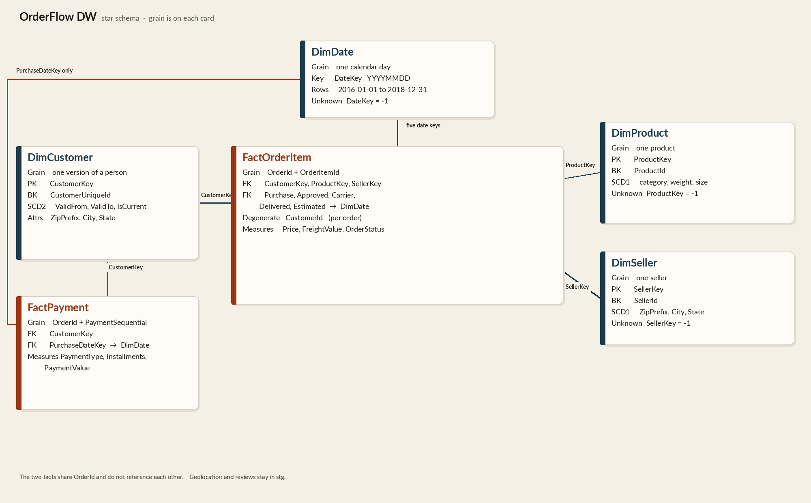
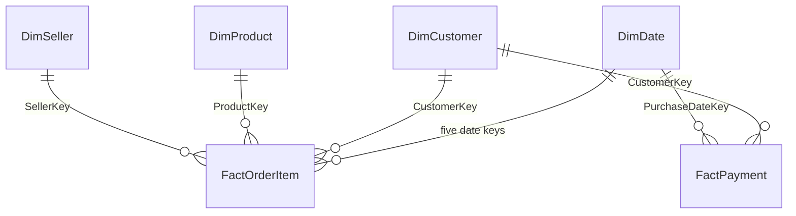

# Star schema

`dw` is a sales and payments star. This file is the build contract for the tables and for the Step 10 load. A table is defined when its grain, its business key, and its surrogate key are fixed. Column lists below are the ones to create.

There is no relationship between `FactOrderItem` and `FactPayment`.

## Model rules

These match the rules at the top of the README and stay fixed from this step on.

- `DimCustomer` is a person. The person is `customer_unique_id`. `customer_id` is one id per order and sits on `FactOrderItem` as a degenerate key.
- `FactOrderItem` grain is `order_id` + `order_item_id`.
- `FactPayment` grain is `order_id` + `payment_sequential`. Payment amounts stay on that fact.
- `DimDate` holds one row per day from 2016-01-01 through 2018-12-31. The order fact has a separate date key for purchase, approval, carrier handoff, delivery, and the estimated delivery.
- Unknown members use surrogate key `-1`.
- Geolocation is loaded into `stg` and left out of the star. ZIP prefixes repeat and the names are dirty.
- Reviews are loaded into `stg` and left out of the star.
- The first tables are rowstore.
- The native `json` type stays unused. It is still in preview on SQL Server 2025.

## Three Olist traps

### The person is `customer_unique_id`

Olist mints a new `customer_id` for every order. The same shopper returns under one `customer_unique_id`. The customer dimension therefore uses `CustomerUniqueId` as its business key. The fact keeps the order's `customer_id` in `CustomerId` so that one order can still be found. That column is not a foreign key, and it is not how the fact reaches `DimCustomer`.

City, state, and ZIP live on the per-order customer row, so one person can show more than one address. The current dimension row takes the address from the latest `order_purchase_timestamp` for that `customer_unique_id`. When two orders share that timestamp, the greater `customer_id` wins. A `customer_unique_id` with no order still loads: use the greatest `customer_id` among its staging rows.

### A payment is not an order item

An order has a set of items and, separately, a set of payments. `price` and `freight_value` belong to one item. `payment_type`, `payment_installments`, and `payment_value` belong to one payment. Those two grains get two facts. Nothing on `FactPayment` points at a product, a seller, or an item, and nothing on `FactOrderItem` stores a payment amount. The facts both carry `OrderId` so a report can combine them. They do not have a foreign key to each other. A sum of `Price` and a sum of `PaymentValue` answer different questions and are not stored on the same row.

### An order has five dates

`stg.Orders` records when the customer purchased, when the order was approved, when the carrier took it, when the customer received it, and the delivery date that was estimated. Each of those is its own key on `FactOrderItem`, all pointing at `DimDate`. `FactPayment` uses only the purchase date, because the payment file has no dates of its own and the purchase is the business date of the order. A missing timestamp, an unreadable timestamp, or a day outside 2016-01-01 through 2018-12-31 becomes date key `-1` for that role alone. `DimDate` has no row for a day outside that range, so the foreign key would reject it. The other four keys on the same item stay as they are.

`shipping_limit_date` is on the item file. It is a seller deadline, not one of the five order dates, and it stays in `stg.OrderItems`.

## `dw.DimDate`

| | |
| --- | --- |
| Grain | One calendar day |
| Surrogate key | `DateKey int`, primary key. The value is `YYYYMMDD`. This table has no identity. |
| Business key | The same `DateKey`. The day is the key. |
| Rows | Every day from 2016-01-01 through 2018-12-31, plus the unknown member |

| Column | Type | Null | Notes |
| --- | --- | --- | --- |
| `DateKey` | `int` | no | Primary key. `20160101` for 1 January 2016. Unknown member is `-1`. |
| `FullDate` | `date` | yes | Null only on the unknown member. |
| `Year` | `smallint` | yes | |
| `Month` | `tinyint` | yes | 1–12 |
| `MonthName` | `nvarchar(20)` | yes | English month name. Unknown member uses `Unknown`. |

## `dw.DimCustomer`

| | |
| --- | --- |
| Grain | One version of one person |
| Surrogate key | `CustomerKey int` identity, primary key |
| Business key | `CustomerUniqueId`. Unique where `IsCurrent = 1`. The same business key repeats once history exists. |
| Change | SCD2 once Step 11 runs. Step 10 keeps one current row. A new `customer_unique_id` is inserted. A changed city, state, or ZIP updates that row and leaves `ValidFrom` at the first load. |

| Column | Type | Null | Notes |
| --- | --- | --- | --- |
| `CustomerKey` | `int` | no | Identity primary key. Unknown member is `-1`, inserted with `IDENTITY_INSERT`. |
| `CustomerUniqueId` | `nvarchar(32)` | no | From `stg.Customers.customer_unique_id`. Unknown member uses `UNKNOWN`. |
| `ZipPrefix` | `nvarchar(8)` | yes | From `customer_zip_code_prefix`. |
| `City` | `nvarchar(100)` | yes | From `customer_city`. |
| `State` | `nvarchar(20)` | yes | From `customer_state`. Wide enough for the unknown label. |
| `ValidFrom` | `datetime2(0)` | no | When this version became current. The first load uses the load timestamp. The Step 10 update of city, state, or ZIP does not change it. |
| `ValidTo` | `datetime2(0)` | yes | Null while the version is current. Set when the version is closed. |
| `IsCurrent` | `bit` | no | `1` on the open version. |

Filtered unique index `UX_DimCustomer_Current` on `CustomerUniqueId` where `IsCurrent = 1`.

The fact does not join to this table on `customer_id`. The path is:

1. `stg.OrderItems.order_id` to `stg.Orders.order_id`
2. `stg.Orders.customer_id` to `stg.Customers.customer_id`
3. `stg.Customers.customer_unique_id` to `dw.DimCustomer.CustomerUniqueId` where `IsCurrent = 1`

The fact stores that row's `CustomerKey`. A later version of the person does not rewrite keys already stored on facts.

## `dw.DimProduct`

| | |
| --- | --- |
| Grain | One product |
| Surrogate key | `ProductKey int` identity, primary key |
| Business key | `ProductId`, unique |
| Change | SCD1. A changed category, weight, or dimension updates the same row. |

| Column | Type | Null | Notes |
| --- | --- | --- | --- |
| `ProductKey` | `int` | no | Identity primary key. Unknown member is `-1`. |
| `ProductId` | `nvarchar(32)` | no | From `stg.Products.product_id`. Unknown member uses `UNKNOWN`. |
| `CategoryNameEnglish` | `nvarchar(100)` | yes | From `stg.ProductCategory.product_category_name_english`, matched on `product_category_name`. Null when the Portuguese name is missing or has no translation. |
| `WeightG` | `int` | yes | From `product_weight_g`. |
| `LengthCm` | `int` | yes | From `product_length_cm`. |
| `HeightCm` | `int` | yes | From `product_height_cm`. |
| `WidthCm` | `int` | yes | From `product_width_cm`. |

`product_name_lenght`, `product_description_lenght`, and `product_photos_qty` stay in `stg.Products`. The Portuguese category name is the lookup key only. It is not a column on the dimension.

A measure that does not cast to `int` is stored as null. The product row still loads. A repeated `product_id` in staging loads once.

## `dw.DimSeller`

| | |
| --- | --- |
| Grain | One seller |
| Surrogate key | `SellerKey int` identity, primary key |
| Business key | `SellerId`, unique |
| Change | SCD1. A changed city, state, or ZIP updates the same row. |

| Column | Type | Null | Notes |
| --- | --- | --- | --- |
| `SellerKey` | `int` | no | Identity primary key. Unknown member is `-1`. |
| `SellerId` | `nvarchar(32)` | no | From `stg.Sellers.seller_id`. Unknown member uses `UNKNOWN`. |
| `ZipPrefix` | `nvarchar(8)` | yes | From `seller_zip_code_prefix`. |
| `City` | `nvarchar(100)` | yes | From `seller_city`. |
| `State` | `nvarchar(20)` | yes | From `seller_state`. |

A repeated `seller_id` in staging loads once.

## `dw.FactOrderItem`

| | |
| --- | --- |
| Grain | One line on one order: `OrderId` + `OrderItemId` |
| Primary key | `(OrderId, OrderItemId)`. No extra surrogate. |
| Business key | The same pair. It is already unique in the source. A repeated pair in staging loads once. |

| Column | Type | Null | Notes |
| --- | --- | --- | --- |
| `OrderId` | `nvarchar(32)` | no | From `stg.OrderItems.order_id`. |
| `OrderItemId` | `int` | no | From `order_item_id`. |
| `CustomerKey` | `int` | no | Foreign key to `dw.DimCustomer`. Current person for the order, or `-1`. |
| `ProductKey` | `int` | no | Foreign key to `dw.DimProduct`, or `-1`. |
| `SellerKey` | `int` | no | Foreign key to `dw.DimSeller`, or `-1`. |
| `PurchaseDateKey` | `int` | no | Foreign key to `dw.DimDate`. From `order_purchase_timestamp`. |
| `ApprovedDateKey` | `int` | no | From `order_approved_at`. |
| `CarrierDateKey` | `int` | no | From `order_delivered_carrier_date`. |
| `DeliveredDateKey` | `int` | no | From `order_delivered_customer_date`. |
| `EstimatedDateKey` | `int` | no | From `order_estimated_delivery_date`. |
| `CustomerId` | `nvarchar(32)` | no | Degenerate key. The order's `customer_id`. Not a foreign key. Null is stored as `UNKNOWN`. |
| `Price` | `decimal(18, 2)` | no | From `price`. |
| `FreightValue` | `decimal(18, 2)` | no | From `freight_value`. |
| `OrderStatus` | `nvarchar(20)` | no | From `stg.Orders.order_status`, repeated on every item of the order. Null is stored as `unknown`. |

`OrderStatus` is copied onto the fact so a sales query does not read `stg`. Date keys are integers, not `date`. The calendar attributes live on `DimDate`.

Foreign keys, all `ON DELETE NO ACTION` and `ON UPDATE NO ACTION`:

| Constraint | Column | References |
| --- | --- | --- |
| `FK_FactOrderItem_Customer` | `CustomerKey` | `dw.DimCustomer (CustomerKey)` |
| `FK_FactOrderItem_Product` | `ProductKey` | `dw.DimProduct (ProductKey)` |
| `FK_FactOrderItem_Seller` | `SellerKey` | `dw.DimSeller (SellerKey)` |
| `FK_FactOrderItem_PurchaseDate` | `PurchaseDateKey` | `dw.DimDate (DateKey)` |
| `FK_FactOrderItem_ApprovedDate` | `ApprovedDateKey` | `dw.DimDate (DateKey)` |
| `FK_FactOrderItem_CarrierDate` | `CarrierDateKey` | `dw.DimDate (DateKey)` |
| `FK_FactOrderItem_DeliveredDate` | `DeliveredDateKey` | `dw.DimDate (DateKey)` |
| `FK_FactOrderItem_EstimatedDate` | `EstimatedDateKey` | `dw.DimDate (DateKey)` |

## `dw.FactPayment`

| | |
| --- | --- |
| Grain | One payment on one order: `OrderId` + `PaymentSequential` |
| Primary key | `(OrderId, PaymentSequential)`. No extra surrogate. |
| Business key | The same pair. A repeated pair in staging loads once. |

| Column | Type | Null | Notes |
| --- | --- | --- | --- |
| `OrderId` | `nvarchar(32)` | no | From `stg.OrderPayments.order_id`. |
| `PaymentSequential` | `int` | no | From `payment_sequential`. |
| `CustomerKey` | `int` | no | Foreign key to `dw.DimCustomer`. Same person lookup as the order fact, or `-1`. |
| `PurchaseDateKey` | `int` | no | Foreign key to `dw.DimDate`. Purchase date of the order, or `-1`. |
| `PaymentType` | `nvarchar(20)` | no | From `payment_type`. Null is stored as `unknown`. |
| `Installments` | `int` | no | From `payment_installments`. |
| `PaymentValue` | `decimal(18, 2)` | no | From `payment_value`. |

| Constraint | Column | References |
| --- | --- | --- |
| `FK_FactPayment_Customer` | `CustomerKey` | `dw.DimCustomer (CustomerKey)` |
| `FK_FactPayment_PurchaseDate` | `PurchaseDateKey` | `dw.DimDate (DateKey)` |

The customer and the purchase date come from the order header (`stg.Orders` joined on `order_id`), then through the same customer path as `FactOrderItem`. A payment whose order is missing from `stg.Orders` still loads, with `CustomerKey = -1` and `PurchaseDateKey = -1`.

## Unknown members

Every foreign key on a fact is `not null`. A missing dimension is the row `-1`, which has to exist before any fact load. Insert it before any real dimension row.

`DimDate` has no identity. Insert `DateKey = -1` directly.

`DimCustomer`, `DimProduct`, and `DimSeller` are identity tables. Insert the `-1` row with `IDENTITY_INSERT` on, then turn it off. Real rows take the next identity value.

| Table | Key | Business key | Other values |
| --- | --- | --- | --- |
| `dw.DimDate` | `DateKey = -1` | same | `FullDate`, `Year`, and `Month` null. `MonthName = Unknown`. |
| `dw.DimCustomer` | `CustomerKey = -1` | `UNKNOWN` | `City` and `State` are `Unknown`. `ZipPrefix` null. `ValidFrom = 1900-01-01`. `ValidTo` null. `IsCurrent = 1`. |
| `dw.DimProduct` | `ProductKey = -1` | `UNKNOWN` | `CategoryNameEnglish = Unknown`. Weight and dimensions null. |
| `dw.DimSeller` | `SellerKey = -1` | `UNKNOWN` | `City` and `State` are `Unknown`. `ZipPrefix` null. |

`UNKNOWN` does not collide with an Olist id. Those ids are 32-character hex strings.

A fact row whose dimension key is anything other than a real surrogate or `-1` must fail the foreign key. That is the check that the unknown member is doing its job.

## What stays out of the star

| Source | Why it stays out |
| --- | --- |
| `stg.Geolocation` | ZIP prefixes repeat and the city names are dirty. |
| `stg.OrderReviews` | Reviews are not part of the sales or payment grain. |
| `shipping_limit_date` | Seller deadline, not one of the five order dates. |
| `product_name_lenght`, `product_description_lenght`, `product_photos_qty` | Not used by the sales star. |
| Portuguese `product_category_name` | Used only to find the English category name. |

## Rows the fact load keeps, and rows it skips

Dimension lookups that miss are not a reason to drop the fact. Casts that destroy the grain or the amount are.

| Situation | What the load does |
| --- | --- |
| `product_id`, `seller_id`, or `customer_unique_id` is null or empty, or is not on the dimension | Keep the fact. Store `-1` on that foreign key. |
| A date is null, does not parse, or falls outside 2016-01-01 through 2018-12-31 | Keep the fact. Store `-1` on that date key only. |
| `order_id` is null or empty | Skip the fact row. The grain is incomplete. |
| `order_item_id` or `payment_sequential` is null or does not parse as `int` | Skip the fact row. The grain is incomplete. |
| `price`, `freight_value`, or `payment_value` is null or does not parse as `decimal` | Skip the fact row. Do not store zero. |
| `payment_installments` does not parse as `int` | Skip the payment row. |
| `customer_id` is null | Keep the fact. Store `CustomerId = UNKNOWN`. |
| `order_status` is null | Keep the fact. Store `unknown`. |
| `payment_type` is null | Keep the fact. Store `unknown`. |
| The same fact grain appears more than once in staging | Keep one row. |
| A product weight or dimension does not parse as `int` | Load the product. Store null in that measure. |
| A product has no English category | Load the product. Store null in `CategoryNameEnglish`. |
| A dimension business key is null or empty | Do not insert a dimension row. Facts that needed it use `-1`. |

Step 14 counts the bad casts. Until that step, the table above is the rule.

## Insert and update, compared with MERGE

The warehouse procedures use a separate `UPDATE` for dimension rows already present and a separate `INSERT` for new business keys. A fact whose grain is already loaded is left unchanged. `MERGE` can do both in one statement, and it can also delete rows missing from the source. One statement hides which branch ran, and a `MERGE` with several `WHEN` clauses is harder to test one action at a time. The two statements make the second-run check obvious: the insert matches nothing, and the row counts stay put. The stand-ins for a null `customer_id`, `order_status`, or `payment_type` are in the skip table above.